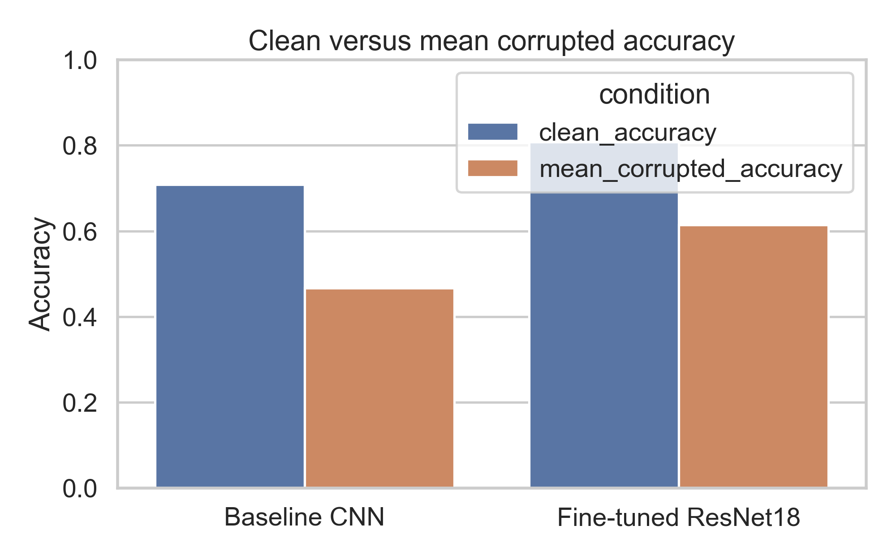
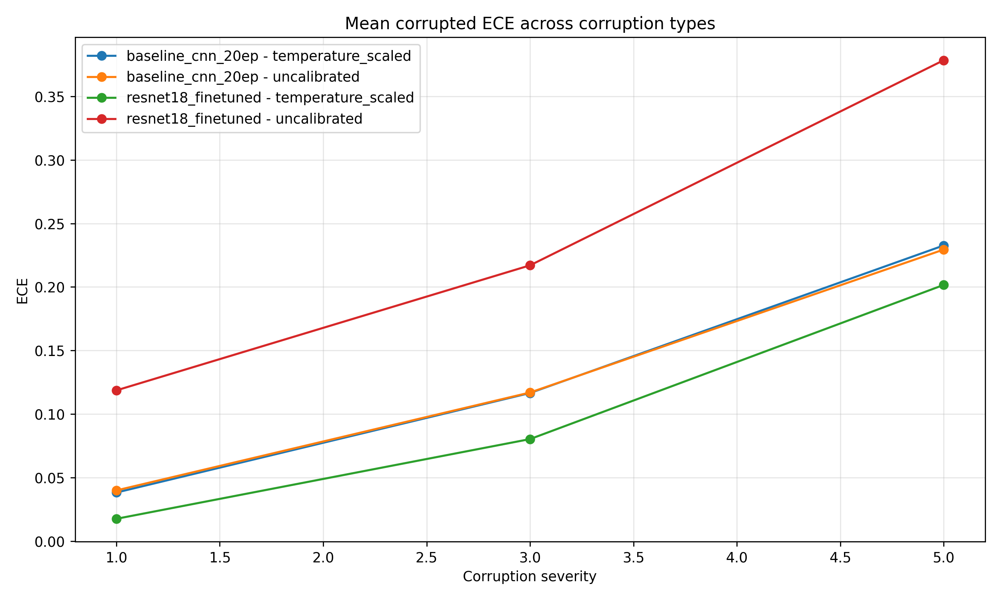
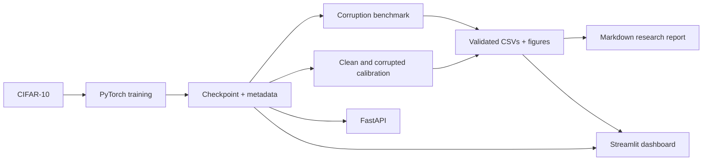

# RobustVision AI

**A reproducible CIFAR-10 robustness and calibration study, with a FastAPI service and Streamlit research dashboard.**

RobustVision AI asks: **when image quality shifts in controlled ways, how much do classification accuracy and confidence reliability change—and does calibration fitted on clean validation data transfer?** Charts, tables, and downloads read saved local artifacts; the dashboard neither invents results nor runs a benchmark implicitly.





## Headline results

All results below come from saved full CIFAR-10 test evaluations: 10,000 examples for every clean or corruption condition.

| Model | Clean accuracy | Mean accuracy across 25 corrupted conditions | Mean accuracy drop |
| --- | ---: | ---: | ---: |
| Baseline CNN | 70.87% | 46.67% | 24.20 percentage points |
| Fine-tuned ResNet18 | 80.82% | 61.43% | 19.39 percentage points |

- The worst measured condition was Gaussian blur at severity 5 for ResNet18 (27.83% accuracy) and Gaussian noise at severity 5 for the CNN (14.97%).
- Clean-validation temperature scaling reduced clean-test ECE from **1.59% to 1.27%** for the CNN and from **11.00% to 1.76%** for ResNet18, without changing top-1 accuracy.
- Under five tested synthetic corruptions at severities 1, 3, and 5, frozen ResNet18 scaling improved mean ECE at every severity (11.86% → 1.75%, 21.70% → 8.03%, 37.85% → 20.16%). The CNN improved slightly at severities 1 and 3 but worsened at severity 5 (22.94% → 23.27%). Calibration transfer is condition- and model-dependent, not universal.

Read the complete traceable analysis in [the research validation report](reports/research_validation.md). It also records the CNN sidecar/benchmark accuracy discrepancy and its limits of interpretation.

## System design



Two saved models are evaluated: a baseline CNN and a fine-tuned torchvision ResNet18. The benchmark applies deterministic Gaussian noise, Gaussian blur, brightness, contrast, and JPEG corruptions. Accuracy, NLL, multiclass Brier score, and equal-width 10-bin ECE are computed from saved experiment outputs. Temperature scaling is fitted once on a deterministic 5,000-image validation split (seed 42) and frozen for the untouched 10,000-image official test split.

## Portfolio artifacts

- [Research report](reports/research_validation.md)
- [Accuracy heatmap](artifacts/analysis/figures/accuracy_heatmap.png)
- [Clean versus corrupted comparison](artifacts/analysis/figures/clean_vs_corrupted.png)
- [Accuracy-drop comparison](artifacts/analysis/figures/accuracy_drop_by_corruption.png)
- [Corrupted ECE comparison](artifacts/calibration_corrupted/mean_ece_by_severity.png)
- [Corrupted NLL comparison](artifacts/calibration_corrupted/mean_nll_by_severity.png)
- [Compact benchmark summary](artifacts/analysis/model_summary.csv)
- [Compact corrupted-calibration summary](artifacts/calibration_corrupted/corrupted_calibration_aggregate.csv)

Large checkpoints, the CIFAR-10 dataset, per-example NPZ files, caches, and MLflow runs are deliberately excluded from version control. The small report figures and summaries above are explicitly allowed by `.gitignore` so a future repository can include portfolio evidence intentionally.

## Setup

Requires Python 3.10–3.13. A CUDA-capable PyTorch build is optional; evaluation selects CUDA when available, or accepts `--device cpu`.

```powershell
python -m venv .venv
.\.venv\Scripts\Activate.ps1
python -m pip install --upgrade pip
python -m pip install -r requirements-dev.txt
```

On Linux/macOS, activate with `source .venv/bin/activate`.

### Dataset acquisition

The downloader first checks `data/downloads/cifar-10-python.tar.gz`. When that archive has the official CIFAR-10 MD5, it safely extracts the torchvision-compatible layout without a network request. Otherwise it falls back to torchvision’s normal HTTPS download with certificate verification intact.

```powershell
python scripts/download_data.py --data-dir data
```

## Reproduce the saved analysis

These commands regenerate derived tables, figures, and the Markdown report from existing checkpoints and experiment CSVs; they do not retrain a model.

```powershell
python scripts/analyze_benchmarks.py `
  --baseline artifacts/benchmarks/baseline_cnn_20ep/robustness.csv `
  --resnet artifacts/benchmarks/resnet18_finetuned/robustness.csv `
  --output artifacts/analysis

python scripts/evaluate_calibration.py `
  --checkpoints artifacts/checkpoints/baseline_cnn_20ep.pt artifacts/checkpoints/resnet18_finetuned.pt `
  --data-dir data --output artifacts/calibration --device auto

python scripts/evaluate_corrupted_calibration.py `
  --checkpoints artifacts/checkpoints/baseline_cnn_20ep.pt artifacts/checkpoints/resnet18_finetuned.pt `
  --data-dir data --clean-calibration-dir artifacts/calibration `
  --output artifacts/calibration_corrupted --severities 1 3 5 --device auto

python scripts/generate_research_report.py `
  --analysis artifacts/analysis --output reports/research_validation.md
```

The corrupted-calibration command resumes valid prediction archives and uses clean-validation-fitted temperatures; it never fits a temperature with corrupted test labels. Clean evaluation writes per-example artifacts and can take several minutes on CPU.

To train a separate experiment (not needed to reproduce reported results):

```powershell
python scripts/train_model.py --model baseline_cnn --epochs 5 --data-dir data --device auto
python scripts/benchmark.py artifacts/checkpoints/baseline_cnn_full.pt --data-dir data --output artifacts/benchmarks --device auto
```

`--quick` uses only 512 training examples and is solely a smoke test; it must not be described as a full CIFAR-10 result.

## Dashboard and API

```powershell
streamlit run app/research_dashboard.py
uvicorn api.main:app --reload --port 8000
```

The dashboard provides saved-checkpoint selection for image inference and Grad-CAM, benchmark model/corruption selectors, measured robustness plots, clean and corruption-aware calibration tables, and CSV downloads. Missing saved artifacts are presented as actionable empty states.

Open `http://127.0.0.1:8000/docs` for live API documentation. Key routes are `GET /health`, `GET /checkpoints`, `GET /corruptions`, `POST /predict/{checkpoint_id}`, and `POST /preview-corruption/{corruption}`. Image uploads are size-limited and validated; callers cannot select arbitrary checkpoint paths.

## Quality checks

```powershell
python -m pytest -q
python -m ruff check .
python -m compileall -q api app src scripts
```

## Project structure

```text
api/                         FastAPI service and request schemas
app/research_dashboard.py    Artifact-first Streamlit research dashboard
artifacts/                   Local checkpoints, metrics, figures, prediction artifacts
configs/                     Configuration defaults
docs/                        Architecture, methodology, API, and limitations
reports/                     Generated research-validation report
scripts/                     Data, training, benchmark, calibration, and report CLIs
src/robustvision/            Reusable models, evaluation, data, tracking, and services
tests/                       Unit, API, and workflow tests
```

## Limitations

- These are controlled CIFAR-10 synthetic-corruption measurements, not a real-world robustness guarantee.
- Repeated inspection of the held-out test set should not drive future model selection; use a new holdout protocol for another model iteration.
- ResNet18 used ImageNet-pretrained initialization with CIFAR normalization rather than the pretrained ImageNet transforms. The result is valid for that configuration, but preprocessing should be compared in a controlled rerun.
- The CNN checkpoint sidecar states 70.88% test accuracy while the saved benchmark clean row and a later read-only evaluation state 70.87%. The exact historical cause cannot be established from saved provenance, so the benchmark CSV governs benchmark comparisons.
- Docker configuration is present, but Docker was unavailable on the validation host and has not been built or run.
- This is a local research tool, not a production service: it has no authentication, rate limiting, remote artifact store, or asynchronous benchmark job queue.

For full caveats and methodology, see [docs/limitations.md](docs/limitations.md) and [docs/methodology.md](docs/methodology.md).

